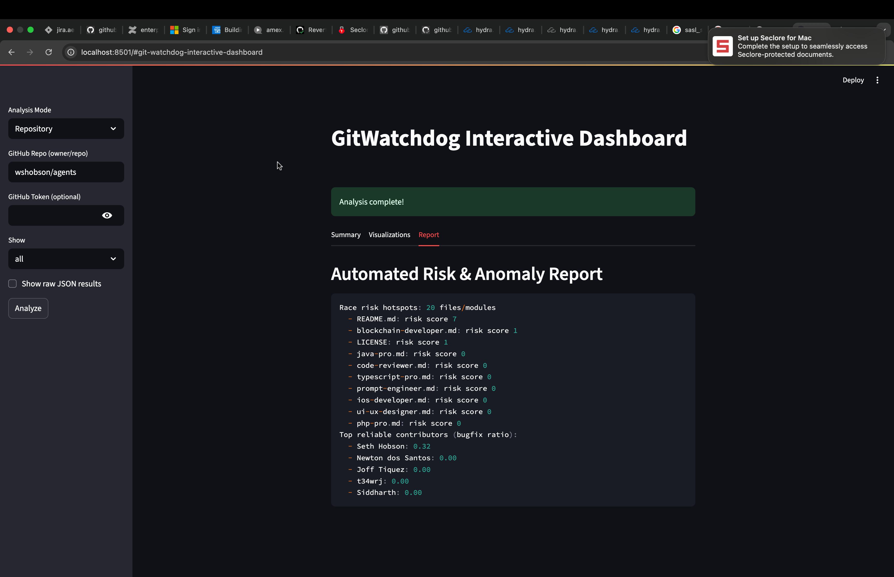
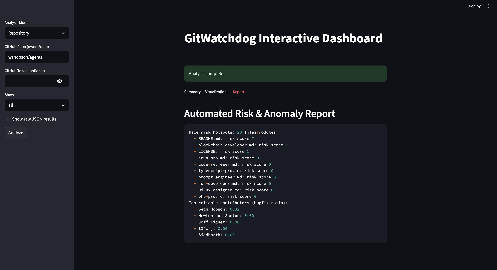
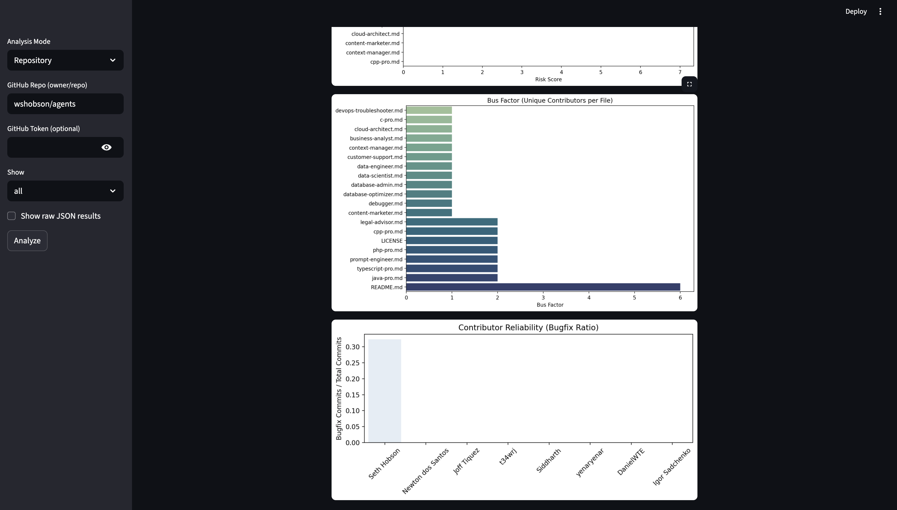
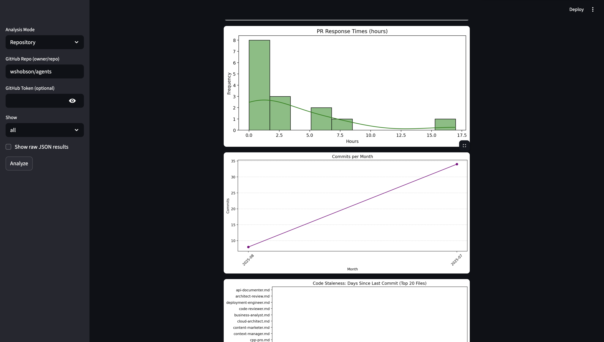
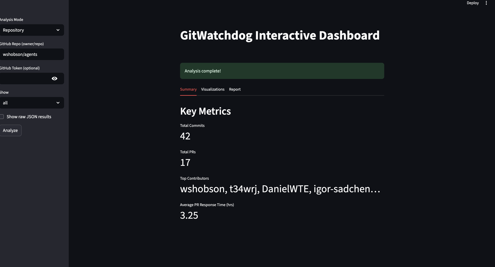

# GitWatchDog

GitWatchdog is a modern tool for profiling GitHub contributor and user behavior. It helps researchers and project maintainers analyze commit and PR activity, visualize trends, and flag anomalies in open-source repositories or for individual users.

## Features
- Analyze commit and pull request behavior for any GitHub repo **or user**
- Visualize activity trends:
  - PRs per month (with anomaly highlights)
  - Response time to PRs (histogram)
  - Top contributors (repo) or top repositories (user)
  - Commit activity over time
  - Contributor share (pie chart)
- Flag anomalies or drops in activity
- Export reports and display interactive graphs
- CLI interface for easy usage
- Supports authenticated requests via `.env` file or `--token` option
- Code Staleness Detector:
  - Identifies files/modules with high inactivity or long intervals between code changes
  - Visualizes staleness (drag-admits) over weeks/months
  - Flags modules with stale contributors
- **Race Condition Profiler for GitHub Projects**: Detects concurrency risks by analyzing overlapping PRs, frequent edits to shared files, and visualizes race risk hotspots.
- **Developer Reliability & Ownership Metrics**: Tracks file/module ownership, bus factor, flags orphaned files, and visualizes contributor reliability.
- **Automated Anomaly & Risk Reports**: Generates dashboards and exportable reports summarizing staleness, race risk, ownership gaps, and anomalous activity.
- **Temporal Analysis & Prediction**: Uses time series analysis to forecast future staleness or risk, visualizing predicted trends.
- **API & Extensibility**: Exports all analysis and metrics in JSON/CSV format for research and integration.
- **Interactive Web Dashboard**: Explore all metrics and visualizations in a modern browser UI.

## Quick Start
1. **Install dependencies**:
   ```bash
   pip install -r requirements.txt
   ```
2. **Set up authentication** (recommended for higher rate limits):
   - Create a `.env` file with:
     ```
     GITHUB_TOKEN=your_personal_access_token
     ```
   - Or pass your token via CLI: `--token <your_token>`
3. **Run repo analysis**:
   ```bash
   python -m gitwatchdog.cli analyze --repo <owner/repo> --show all
   ```
4. **Run user analysis**:
   ```bash
   python -m gitwatchdog.cli analyze --user <github_username> --show all
   ```
5. **Export report**:
   ```bash
   python -m gitwatchdog.cli analyze --repo <owner/repo> --export report.csv
   ```
6. **Run temporal risk prediction**:
   ```bash
   python -m gitwatchdog.cli analyze --repo <owner/repo> --show prediction --export report.md
   ```
7. **Launch the interactive dashboard**:
   ```bash
   streamlit run dashboard.py
   ```

## Example Visualizations
- PRs per month (bar chart, anomaly highlights)
- Top contributors (repo) or top repositories (user)
- Contributor share (pie chart)
- PR response time (histogram)
- Commit activity (line chart)
- Activity anomaly detection
- **Code staleness per file/module (bar chart, summary)**
- **Race risk hotspots (heatmap/bar chart)**
- **Ownership and bus factor graphs**
- **Temporal risk prediction (bar chart, exportable)**
- **Interactive dashboard for all metrics**

## Technologies Used
- Python 3.8+
- PyGithub (GitHub API)
- matplotlib, seaborn, plotly (visualization)
- Click (CLI)
- pandas (data export)
- python-dotenv (environment management)
- Streamlit (web dashboard)


## Screenshots

| Dashboard | Metrics | Visualizations |
|-----------|---------|----------------|
|  |  |  |
|  |  | |

---
